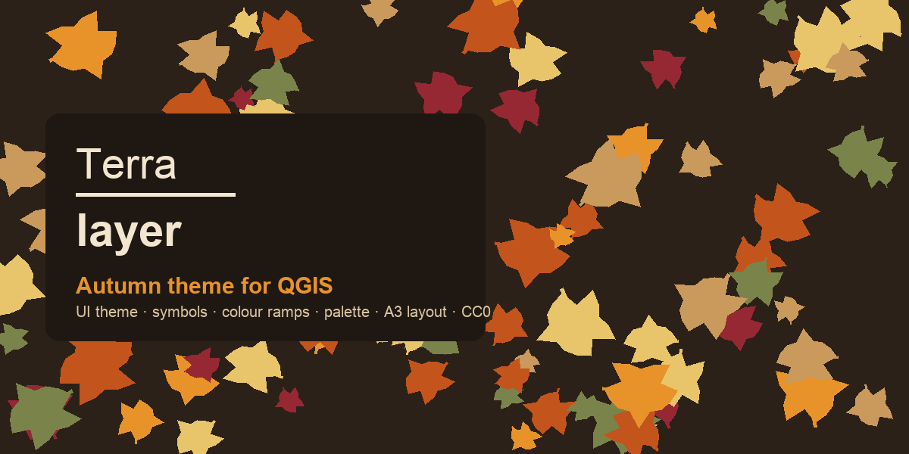
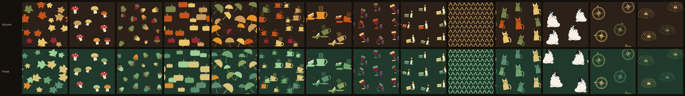
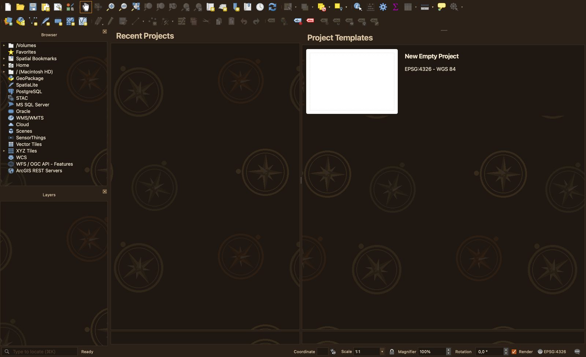
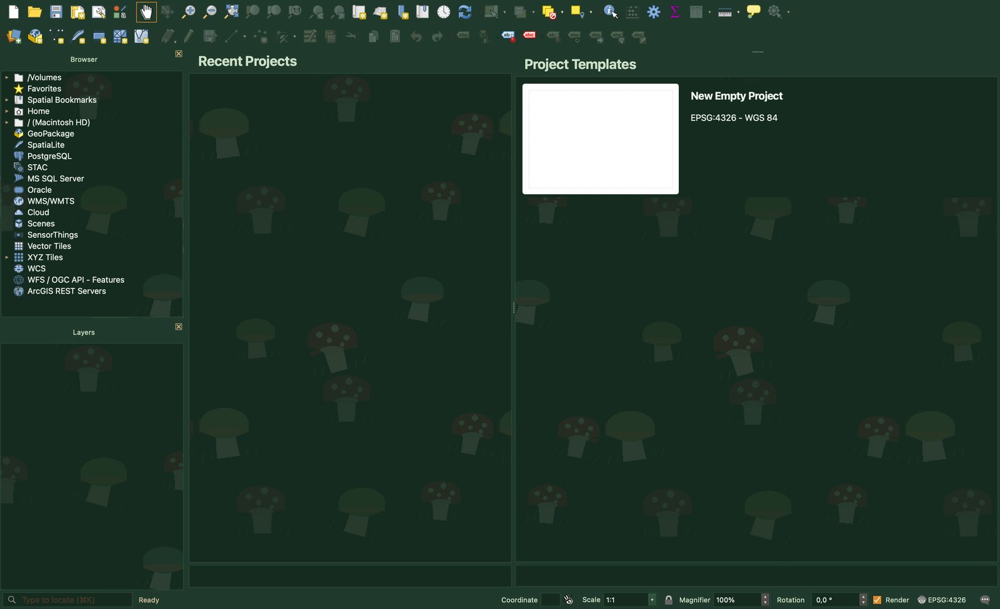
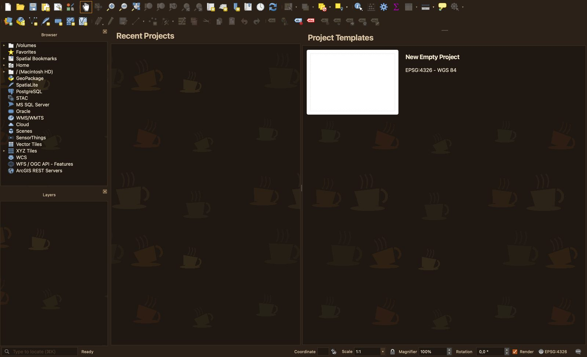
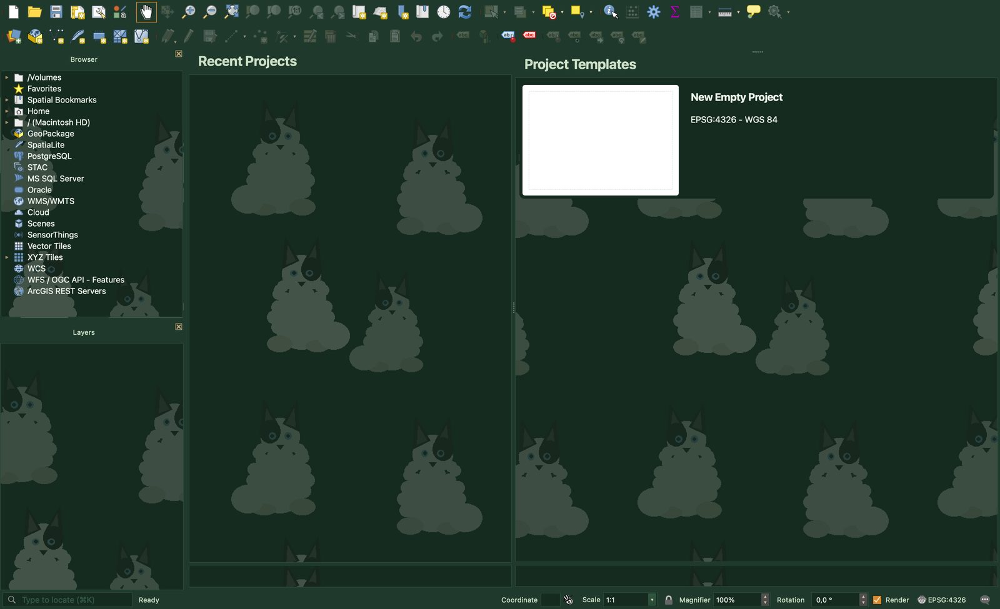
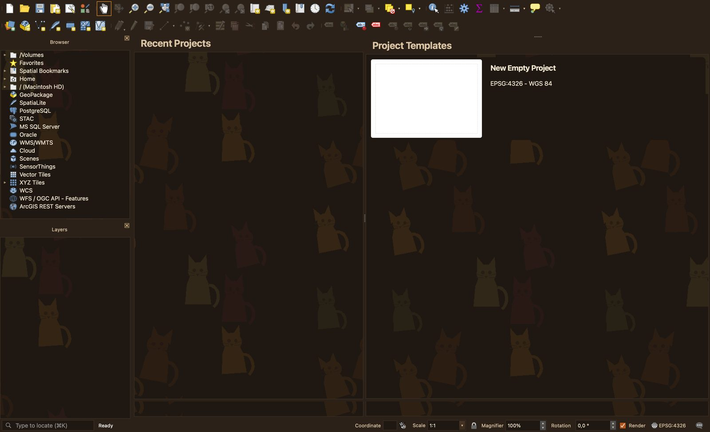
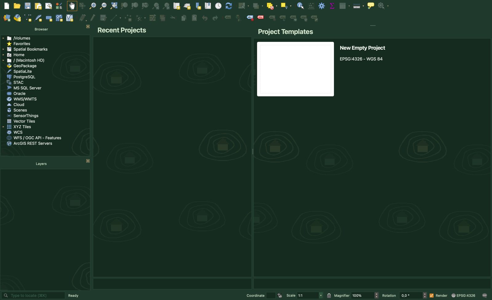
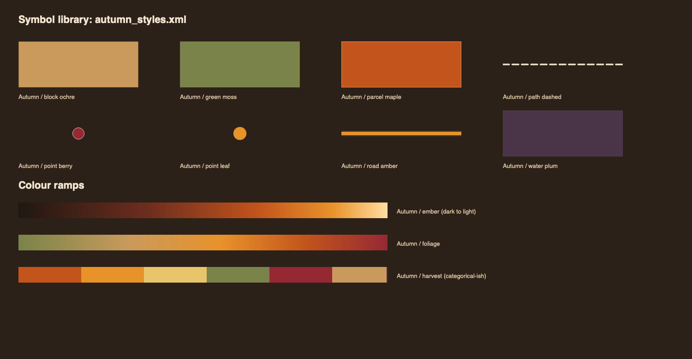

# Autumn & Forest themes for QGIS

Thirty interface themes for QGIS: fifteen faint panel patterns in two dark palettes, **Autumn** (espresso, walnut, amber, ochre) and **Forest** (fir green, sage, amber accents). Plus a matching symbol library, three colour ramps, a colour palette and an A3 print-layout template.

A product of **Terra Layer**. Free to install and use in your own maps, including client work. Licence **CC BY-NC-ND 4.0**: credit Terra Layer, do not sell or redistribute modified versions. See [LICENSE](LICENSE). For commercial licensing or custom themes, contact Terra Layer.

## Patterns

Leaves · Mushrooms · Acorns · Pumpkins · Rain · Cups · Tea & Cake · Wine · Candlelight · Knit · Cats · Dogs (Yakutian laikas) · Compass · Contours · Plain (no pattern). Every pattern exists in both palettes, so the theme list in QGIS reads `Autumn Cups`, `Forest Cups`, and so on.

The pattern sits only on dock panels and item views (Browser, Layers, lists) and is deliberately faint. Toolbars, menus, dialogs and the map canvas stay clean.

| | |
|---|---|
|  |  |
|  |  |
|  |  |

Screenshots of all thirty themes are in [`previews/`](previews/) and in the [PDF](https://github.com/Terra-Layer/qgis-autumn-themes/releases).

## Install

**1. Interface theme.** Copy one or more folders from [`themes/`](themes/) into the `themes` folder of your QGIS profile, then restart QGIS and choose the theme in **Settings → Options → General → UI theme**.

Where the profile folder is: **Settings → User profiles → Open active profile folder**. Create `themes/` inside it if it does not exist. Typical paths:

- Windows: `%APPDATA%\QGIS\QGIS3\profiles\default\themes\`
- macOS: `~/Library/Application Support/QGIS/QGIS3/profiles/default/themes/`
- Linux: `~/.local/share/QGIS/QGIS3/profiles/default/themes/`

**2. Symbols and colour ramps.** **Settings → Style manager → Import/Export → Import items** → `autumn_styles.xml`. Adds eight symbols (fills, lines, markers) and three ramps: *foliage* (continuous), *ember* (dark to light), *harvest* (categorical).

**3. Colour palette.** In any colour dialog: palette dropdown → **Import palette** → `autumn_palette.gpl`. Twelve named colours.

**4. Print layout.** **Project → New print layout from template** → `autumn_layout.qpt`. A3 landscape, dark page, amber scale bar, credits line. Uses the free fonts Manrope and IBM Plex Sans; QGIS substitutes if they are missing.

## Tweak

- Pattern too strong or too faint: replace `icons/leaves-subtle.png` (panels) and `icons/leaves-dark.png` (tree and list views) inside the theme folder with your own 480×480 tile. Any seamless PNG works.
- No pattern at all: use `Autumn Plain` or `Forest Plain`.
- Colours: edit `variables.qss` in the theme folder; every colour is named there.
- Code editor (Python console, SQL): colours live in `qscintilla.ini`.

## Compatibility

Themes are plain Qt stylesheets and PNG tiles, the same format as the built-in *Night Mapping* theme, so they run wherever QGIS runs. Tested on QGIS 3.44 on macOS. Expected to work on QGIS 3.28 and newer on Windows and Linux; if something looks off on your system, please open an issue with a screenshot and your QGIS version.

## Licence

© 2026 Terra Layer. CC BY-NC-ND 4.0. You may use the themes and share them unchanged with credit; you may not sell them, include them in paid products, or distribute modified copies. The base stylesheet derives from the QGIS *Night Mapping* theme (GPL); Terra Layer's patterns, palettes, symbols, layout and documentation are under the terms above.

## Colours

**Autumn**: Espresso `#2b2118` · Walnut `#3d2f23` · Dry oak `#8a6d4a` · Ochre `#c99a5b` · Golden leaf `#e8c46a` · Amber `#e8922a` · Burnt orange `#c2541c` · Berry `#962834` · Moss `#7a844a` · Plum `#4a3448` · Parchment `#d9c3a3` · Cream `#f3e6d0`

**Forest**: Fir `#1f3a2c` · Pine `#2a4a37` · Moss `#5f8a66` · Sage `#9ccf96` · Birch `#d9c27a` · Amber `#d9892e` · Mist `#cfe0c8` · Snow `#eef5ea`
